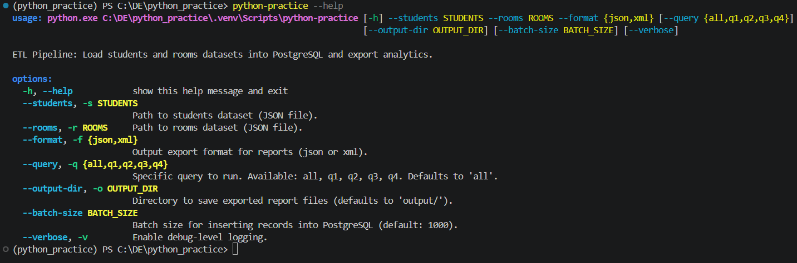
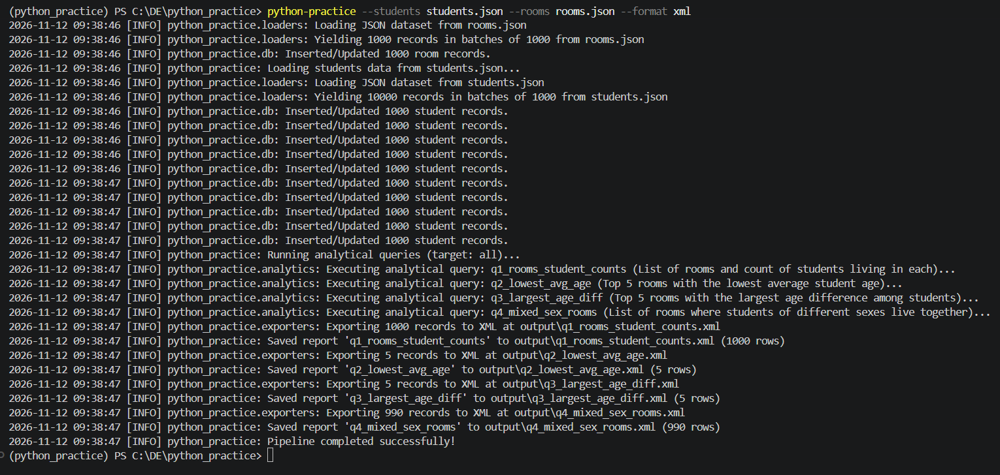

# Python Practice: ETL Pipeline & Analytics

An ETL pipeline that extracts data from JSON files (students and rooms), loads it into a PostgreSQL database, performs analytical SQL queries, and exports the results in JSON or XML format.

## Tech Stack

* **Python 3.12+**
* **PostgreSQL 16** (via Docker)
* **psycopg 3** (PostgreSQL driver, no ORM)
* **Docker & Docker Compose**
* **uv** (Dependency manager)

## Features

* **Relational database schema** with a many-to-one relationship.
* **Pure SQL data ingestion** (no ORM).
* **Database-level processing:** All mathematical operations (aggregations, sorting) are handled at the database level.
* **Query optimization** using composite indexes.
* **OOP design** following SOLID principles.
* **CLI interface** supporting `--students`, `--rooms`, `--format`, and dynamic query flags.

## Architecture & Project Structure

The project is designed adhering to **SOLID** principles and **Dependency Injection** (dependencies are initialized in `main.py` and passed to the `CommandLineInterface` orchestrator).

```text
python_practice/
├── docker-compose.yml              # PostgreSQL container configuration
├── pyproject.toml                  # Package dependencies and metadata
├── docs/                           # CLI execution screenshots and logs
├── tests/                          # Unit test suite (pytest)
└── src/python_practice/
    ├── main.py                     # Entry point (Composition Root & Dependency Injection)
    ├── cli.py                      # CLI argument parsing and pipeline orchestration
    ├── config.py                   # Configuration loading and connection string (DSN) assembly
    ├── db.py                       # Connection management, schema initialization, and batch inserts
    ├── loaders.py                  # Streaming data loaders (BaseLoader / JsonLoader)
    ├── analytics.py                # SQL report execution engine managed via registry
    ├── exporters.py                # Data exporters (JSON / XML) and exporter factory
    └── sql/
        ├── schema.sql              # DDL schema for tables and composite indexes
        ├── queries.json            # Analytical reports registry (q1–q4)
        ├── query001.sql            # Number of students in each room
        ├── query002.sql            # Top 5 rooms with lowest average student age
        ├── query003.sql            # Top 5 rooms with largest age difference
        └── query004.sql            # Rooms with students of different sexes
```

## Installation & Setup

### 1. Prepare Data

Ensure `students.json` and `rooms.json` are in the project root. If they are missing, place them next to `pyproject.toml`.

### 2. Environment Variables

Create a `.env` file in the project root with the following content:

```env
DB_HOST=localhost
DB_PORT=5432
DB_NAME=python_practice_db
DB_USER=postgres
DB_PASSWORD=postgrespassword
```

### 3. Start the Database

Run the following command to start the PostgreSQL container:

```bash
docker compose up -d
```

### 4. Install Dependencies

Run the following command to install the required packages:

```bash
uv sync
```

### 5. Run the Pipeline

Execute the main ETL script as a module:

```bash
python -m python_practice.main --students students.json --rooms rooms.json --format json
```

*(Alternatively, if your environment is activated, you can also use `python-practice --students students.json --rooms rooms.json --format json`)*

## Usage Examples

### Screenshots

#### CLI Help Output



#### Successful Pipeline Execution



### Available CLI Parameters

| Parameter | Short | Required | Default | Description |
| :--- | :---: | :---: | :---: | :--- |
| `--students` | `-s` | **Yes** | — | Path to students JSON file |
| `--rooms` | `-r` | **Yes** | — | Path to rooms JSON file |
| `--format` | `-f` | **Yes** | — | Export format (`json` or `xml`) |
| `--query` | `-q` | No | `all` | Specific query to run (`all`, `q1`, `q2`, `q3`, `q4`) |
| `--output-dir` | `-o` | No | `output/` | Output directory for saved reports |
| `--batch-size` | — | No | `1000` | Batch size for database inserts |
| `--verbose` | `-v` | No | `False` | Enable debug-level logging |

## Running Tests

Run the unit test suite using `pytest`:

```bash
uv run python -m pytest -v
```

## Analytical Queries

All calculations are performed on the PostgreSQL side. Queries are stored in `src/python_practice/sql/` and managed via `queries.json`.

* **`q1`**: List of rooms and the number of students in each.
* **`q2`**: Top 5 rooms with the lowest average student age.
* **`q3`**: Top 5 rooms with the largest age difference among students (`max - min`).
* **`q4`**: List of rooms where students of different sexes live together.

## Optimization (Indexes)

To speed up analytical queries, the following indexes are added in `schema.sql`:

* **`idx_students_room_birthday`**: Designed for `q2` and `q3` (age aggregation and calculations).
* **`idx_students_room_sex`**: Designed for `q4` (mixed-sex rooms lookup).